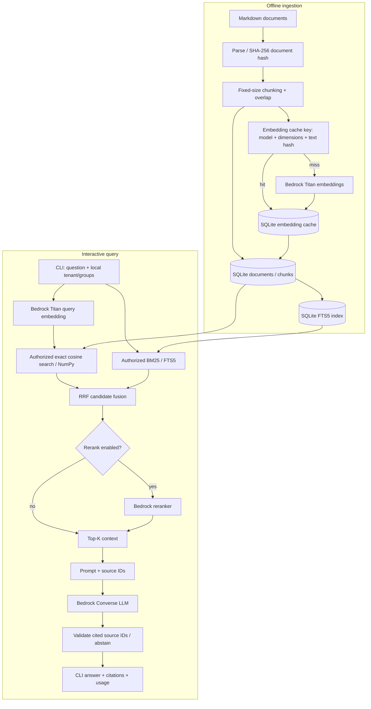

# Enterprise RAG — Multi-Tenant Knowledge Assistant

A **local-first, CLI-based Retrieval-Augmented Generation (RAG) proof of concept** using Python, SQLite and Amazon Bedrock. It demonstrates document ingestion, content-addressed embedding reuse, hybrid retrieval (semantic + keyword), optional model-based reranking, grounded answer generation with source references, evaluation, and basic operational instrumentation.

> **Scope:** An architecture and learning POC, **not a production-secure multi-tenant service**. Tenant/group values are supplied by the local operator, source markers are checked for validity but not automatically for factual support, and indexing is designed for a small dataset and a single local process.

## 1. What this project demonstrates

- Parse Markdown documents and preserve metadata, source offsets and document versions.
- Split documents into overlapping chunks and reuse unchanged embeddings through SHA-256 caching.
- Store document/chunk metadata and vector bytes in SQLite; run keyword retrieval with FTS5/BM25.
- Compute query embeddings with **Amazon Titan Text Embeddings V2** via Bedrock, and perform exact cosine similarity with NumPy.
- Merge keyword and semantic results with **Reciprocal Rank Fusion (RRF)**.
- Optionally rerank authorized candidates using **Cohere Rerank 3.5 on Amazon Bedrock**.
- Generate answers through **Bedrock Converse**, associate `[S1]`, `[S2]` citations with retrieved chunks, and abstain when no evidence is retrieved or response validation fails.
- Compare retrieval with and without reranking; manually evaluate correctness, citation support and abstention.
- Measure retrieval/generation latency and token usage; use SDK retries/timeouts and structured JSON logs.

## 2. Architecture



**Trust boundary:** The local CLI's `--tenant` and `--groups` flags are *test inputs*, not verified identity. SQL retrieval applies tenant and current stored document-group filters, but production use requires authenticated principals, centralized authorization and revocation-aware caches. Authorized filtering must happen **before** source content is sent to a reranker or LLM.

## 3. Component map

| Component | Main file(s) | Responsibility |
|---|---|---|
| Document models | `src/enterprise_rag/models.py` | Document/chunk contracts, ownership and citation offsets |
| Parsing | `ingestion/parser.py` | Read Markdown; normalize line endings; hash file bytes |
| Chunking | `ingestion/chunker.py` | Split into character-based overlapping spans |
| Ingestion | `ingestion/service.py`, `ingestion/indexer.py` | Create document/chunks, lookup or generate embeddings, update active index |
| Embedding providers | `embeddings/provider.py` | Deterministic fake model for tests; Bedrock Titan model for semantic retrieval |
| SQLite storage | `storage/index.py` | Documents, chunks, vectors, FTS5 and atomic active-document replacement |
| Vector retrieval | `retrieval/vector_search.py` | Filter eligible chunks and score cosine similarity |
| Keyword retrieval | `retrieval/keyword_search.py` | FTS5/BM25 lexical matching with tenant/group filtering |
| Hybrid search | `retrieval/hybrid.py` | Combine lists via RRF; optionally invoke reranker |
| Reranker | `retrieval/reranker.py` | Bedrock Rerank API; map scores back to original source IDs |
| Prompt assembly | `generation/prompt.py` | Package authorized chunks, assign deterministic source markers per answer |
| Generation service | `generation/service.py` | Orchestrate stages; abstention and citation-ID checks; metrics |
| Generation provider | `generation/provider.py` | Bedrock Converse model calls |
| Reliability | `aws_config.py`, `errors.py`, `observability.py` | AWS retry/timeout config, application errors, structured logging |
| Interactive UI | `src/ask.py` | CLI session, tenant/group test context, optional reranking, citations and timings |
| Evaluation | `scripts/evaluate_retrieval.py`, `scripts/evaluate_generation.py` | Retrieval benchmarks and human-scored answer evaluation |

Paths in the component table are relative to `src/enterprise_rag/` unless otherwise specified.

## 4. Technical choices and tradeoffs

| Choice | Benefit | Cost / limitation | When to revisit |
|---|---|---|---|
| **SQLite + FTS5** | Zero service operations, persistent and efficient for small corpora | Limited concurrency and distributed scaling | Many writers, high QPS, large corpora |
| **NumPy exact vector scan** | Easy to understand, exact scoring, no ANN infrastructure | O(N) over eligible vectors/query and memory/I/O growth | Hundreds of thousands+ chunks or strict latency SLOs |
| **Bedrock Titan embeddings** | No local model memory or GPU required | API cost, network latency, AWS dependency | Need offline operation or lower marginal cost at volume |
| **256-dimensional vectors** | Compact cache and fast scans | May underperform larger representations for some datasets | Evaluate 256 vs 512/1024 using labeled queries |
| **Fixed-character chunks with overlap** | Small, deterministic baseline | Splits semantics and can shift many downstream chunk boundaries | Improve to heading-/token-aware chunking |
| **SHA-256 text + model cache** | Avoids re-embedding identical chunks, independent of document versions | Cache keys need complete model/config identity; orphan vectors accumulate | Model migration, multimodel support, garbage collection |
| **Hybrid BM25 + vector retrieval** | Captures exact terms and paraphrases | More tuning and two ranking branches | Examine query types and per-branch value |
| **RRF** | Combines heterogeneous scores without calibration | Ignores absolute score magnitude; cannot establish answerability | Learned fusion, query-specific weighting |
| **Bedrock reranking (optional)** | Better final ordering in some workloads | Added cost/latency; limited by candidate recall | Measure Recall@K, NDCG@K and latency before enabling by default |
| **Prompt + citation-ID validation** | Traceable source IDs, catches fabricated references | Does *not* prove each claim follows from evidence | Add claim-level attribution, groundedness judge + human checks |
| **CLI instead of HTTP service** | Minimal resources and complexity; fast iteration | No actual authentication, multi-user control or deployment contract | Production service/API needed |

### Content-addressed caching and update behavior

- Document SHA-256 detects byte-level changes; chunk SHA-256 plus embedding model/dimensions determines vector reuse.
- An unchanged chunk can reuse a cached embedding even if its document version changes or it appears in another document.
- Active chunks for a document are replaced transactionally; unused cached embeddings may remain and should eventually be garbage-collected.
- Fixed-position chunking can invalidate many subsequent chunks after an insertion. Structure-aware splitting or content-defined chunking improves reuse.
- Treat a shared embedding cache only as an **internal optimization**. Never expose cache-hit status or shared content across authorization boundaries.

## 5. Local development environment

Recommended for the original POC: **Ubuntu, Intel i3, 8 GB RAM**. No GPU, Docker, OpenSearch cluster, or locally hosted LLM is required.

### Prerequisites

- Python 3.11 or newer and `python3-venv`.
- AWS account with available Bedrock model access and billing/credits configured.
- AWS CLI with valid credentials (or equivalent SDK credential provider).
- Bedrock access to Titan Text Embeddings V2; a Converse-compatible generation model; optionally a reranking model.

**Important:** A free Claude chat subscription does **not** automatically include Anthropic API credits. This repository uses Bedrock for its configured generation model. Verify your Region, inference profile, IAM permissions and applicable pricing before running paid tests.

### Clone and set up

```bash
# From the project root
python3 -m venv .venv
source .venv/bin/activate
python -m pip install --upgrade pip
pip install pydantic pytest pypdf numpy boto3

# Sanity checks
aws sts get-caller-identity
PYTHONPATH=src python -c 'from enterprise_rag.generation.service import RAGService; print("Imports OK")'
```

If the repository includes a maintained `pyproject.toml` or requirements lockfile, use that as the dependency source instead of the direct `pip install` command above.

### AWS configuration

```bash
aws configure
export AWS_REGION=us-east-1
export RAG_LLM_MODEL_ID="us.amazon.nova-lite-v1:0"
```

`RAG_LLM_MODEL_ID` is **an example**. Use a model/inference profile that your AWS account can invoke in your selected Region. The generation client uses Bedrock Converse. The embedding code uses `amazon.titan-embed-text-v2:0` with 256 dimensions; query and indexed documents must use compatible embedding configurations. The optional reranker is configured for `cohere.rerank-v3-5:0` in the example code, subject to regional support and permissions.

For least privilege, scope relevant `bedrock:InvokeModel` and `bedrock:Rerank` permissions to the exact supported resources and verify any required model access settings. Never commit local credentials or access tokens.

## 6. Commands

Commands below follow the Makefile targets used during the POC. Check your local `Makefile` if you have renamed any targets.

### Ingest example documents

```bash
# Ingest the sample file defined in the original project
PYTHONPATH=src python run_indexing.py
```

The example indexer creates/updates `data/index/rag.db`. Its sample script may default to the **fake embedding provider**; switch to the Bedrock provider in that script before testing semantic search with Bedrock. Index **all documents**, not just the first sample file, using your document ingestion loop/scripts. Re-running unchanged text should report cache hits.

### Interactive question-answering

```bash
# Existing Makefile shortcut (configured for acme / sre platform)
make ask

# Optional reranking
make ask-rerank

# Direct command; explicit environment and principal context
RAG_LLM_MODEL_ID="us.amazon.nova-lite-v1:0" \
PYTHONPATH=src python src/ask.py \
  --tenant acme --groups sre platform

# Enable Bedrock reranking
RAG_LLM_MODEL_ID="us.amazon.nova-lite-v1:0" \
PYTHONPATH=src python src/ask.py \
  --tenant acme --groups sre platform --rerank
```

Within the CLI, ask questions at `rag>`; use `/help`, `/clear`, `/exit`, `/quit`. **Each question is currently independent**—follow-up pronouns are not resolved from conversation history.

### Retrieval evaluation (no answer-generation LLM)

```bash
make eval-retrieval
make eval-retrieval-rerank

# Equivalent direct commands
PYTHONPATH=src python scripts/evaluate_retrieval.py \
  --dataset data/evaluation/retrieval.json --region us-east-1

PYTHONPATH=src python scripts/evaluate_retrieval.py \
  --dataset data/evaluation/retrieval.json --region us-east-1 --rerank
```

Expected output files: `reports/baseline.json` and `reports/rerank.json`.

These runs measure document-level Recall@5, MRR@5, NDCG@5 and latency. Label ground-truth documents **before** inspecting model predictions. A reranker can improve ordering of an existing candidate pool, but not recover candidates the first-stage retriever missed.

### Manually score generated answers

```bash
make eval-manual
make eval-manual-rerank

# Quick three-question smoke test
RAG_LLM_MODEL_ID="us.amazon.nova-lite-v1:0" \
PYTHONPATH=src python scripts/evaluate_generation.py \
  --tenant acme --groups sre --limit 3
```

The manual evaluator prompts for:

- Correctness: `0` wrong, `1` partial, `2` correct.
- Citation support: `s` supported, `p` partial, `u` unsupported, `n` not applicable.
- Abstention: `c` correct or `i` incorrect.

It writes `reports/manual_generation.json` and `reports/manual_generation.csv`. It resumes completed IDs on subsequent runs. **Do not mix different models, datasets, tenant/group configurations or reranking modes in the same report**; use separate report paths or preserve copies before comparing runs. For citation support, inspect the actual cited chunk text, not just the source identifier.

### Tests and verification

```bash
make test-reliability
make verify

# Direct equivalents
PYTHONPATH=src python -m compileall -q src
PYTHONPATH=src pytest -q
```

Keep live AWS integration tests separate from mocked unit tests to avoid unplanned API costs.

## 7. Retrieval and generation behavior

1. **Query input:** the local user enters a question under a selected tenant/group test context.
2. **Parallelizable retrieval paths:** Titan query embedding → exact cosine similarity; and FTS5/BM25 keyword matching. Both retrieve from the eligible tenant/document set.
3. **Fusion:** RRF combines ranked candidates; duplicate chunks are merged.
4. **Optional rerank:** Bedrock scores only already-authorized candidates, reorders them and selects top K.
5. **Context assembly:** selected chunks receive short source IDs (`[S1]`, `[S2]`) that map back to original chunk IDs, document IDs and character offsets.
6. **Generation:** Bedrock Converse answers from supplied context; the system requests citations and abstention on insufficient evidence.
7. **Validation:** rejects unknown citation IDs and incomplete outputs; an exact abstention response is allowed without citation markers.
8. **Observability:** emits request/stage timings and token usage without logging prompt text by default.

**Known limitation:** a vector search always has near neighbors even for irrelevant questions. RRF relevance scores are not calibrated probabilities, and an apparently valid citation may not actually support its claim. Evaluations should include unanswerable and adversarial cases.

## 8. Quality evaluation strategy

| Dimension | Method | Goal |
|---|---|---|
| Candidate recall | Recall@20 | Did first-stage retrieval find relevant evidence? |
| Final ranking | Recall@5, MRR@5, NDCG@5 | Did correct documents surface early? |
| Answer correctness | Human scores 0 / 1 / 2 | Is response accurate and complete? |
| Citation support | Human scores supported / partial / unsupported | Do cited spans support assertions? |
| Abstention | Correct / incorrect | Does system decline unsupported requests? |
| Isolation | Tenant and ACL negative tests | No unauthorized content reaches retrieval outputs or models |
| Operations | Retrieval latency, generation latency, input/output tokens | Quality/latency/cost tradeoffs |

Compare baseline and reranked settings using identical source documents, labels, model configuration and query sets. Report measured values, not example numbers. With only 10–20 documents, reranking may offer little improvement; that itself is a valid finding.

## 9. Reliability and security model

**Implemented in the POC**

- SDK-configured connect/read timeouts and standard backoff/retries for recognized transient failures.
- Application-level error translation for embedding, reranking and generation requests.
- Transactional replacement of a document's active chunks.
- Backend SQL filters for tenant and document-level allowed groups.
- Rejection of invented source IDs; no answer-generation call when retrieval returns no candidates.
- Structured JSON logs with stage latency, request ID and token counts.

**Not yet a production guarantee**

- Caller-supplied CLI tenant/groups are **not authenticated or authorized**.
- No robust revocation/change propagation to distributed caches, index replicas or in-flight requests.
- No idempotent distributed ingestion workflow, optimistic version concurrency control or dead-letter queue.
- No per-claim entailment verification or comprehensive prompt-injection defense.
- No request-level hard deadline, circuit breaker, budget enforcement or cross-request quota management.
- No multi-user concurrency testing or SLO-backed load tests.
- Local DB and source files are not an enterprise backup, encryption, auditing or retention solution.

## 10. Production-readiness roadmap

Prioritize improvements by **risk and operational value**, not by number of infrastructure services added.

### P0 — Correctness, tenant safety and traceability (required before external users)

1. **Real authentication and authorization:** use OIDC/JWT or AWS IAM identity, derive tenant and group membership from verified claims, deny by default and authorize every read/write. Support user-specific ACLs, deny rules and revocation semantics.
2. **Harden tenant isolation:** choose index-per-tenant or enforced tenant/ACL filters suitable for the datastore. Test all retrieval branches, caches, reranker inputs, generation context and citations for cross-tenant leakage.
3. **Durable ingestion state:** use document lifecycle states (pending/indexing/active/failed), idempotency keys, monotonic version checks, deletions, atomic active-index swaps and retry-safe upserts.
4. **Groundedness controls:** maintain precise evidence spans; inspect source contents; evaluate unsupported claims and prompt injections. Use explicit no-answer behavior when evidence is insufficient.
5. **Secrets and data handling:** least-privilege IAM, private data storage, encryption at rest/in transit, retention/deletion policies, sanitized logs and audit trails.

### P1 — Scale, latency and resilience

6. **Index migration:** move vector/BM25 search to an appropriate service (OpenSearch, PostgreSQL+pgvector with a lexical strategy, or a dedicated vector database) when measured dataset size and query concurrency justify it. Validate ACL-filtered recall and performance.
7. **Better chunking:** Markdown heading/paragraph, PDF page/table-aware extraction, token-aware budgets, parent-child retrieval, document and section-level deduplication.
8. **Efficient embedding ingestion:** batches, bounded concurrency, retries with jitter, rate limits, queue/DLQ, incremental updates and orphan-cache garbage collection.
9. **Bounded query path:** deadlines, retry budgets, circuit breakers, bulkheads, graceful degraded modes and per-tenant fairness limits. Do not stack unbounded SDK and application retries.
10. **Caching strategy:** cache query embeddings and optionally retrieval results under scoped authorization/version keys; invalidate immediately or fail closed on permission revocation.
11. **Operational platform:** immutable configuration, telemetry with p50/p95/p99 per stage, distributed traces, token/cost budgets, alerts and SLOs.

### P2 — Product capability and quality optimization

12. **Answerability detection:** combine explicit identifier matching and calibrated evidence sufficiency; avoid treating RRF scores as confidence probabilities.
13. **Adaptive retrieval:** route exact-ID questions to structured/keyword lookup and semantic queries to hybrid retrieval. Tune fusion weights, candidate sizes and reranking policies by evaluation.
14. **Conversation awareness:** session-scoped history and query rewriting with strict tenant isolation, history retention controls and defense against context contamination.
15. **Continuous evaluation:** version datasets and model configurations; add regression gates, gold evidence spans, negative/security suites, canary rollout and shadow tests.
16. **Optional service interface:** add FastAPI only when real multi-user access or integration is required; introduce auth, rate limiting, pagination, deployment and API contracts together.

## 11. Suggested benchmark and architecture report

Record the following in `reports/` and link them from this README after running the actual experiments:

```text
reports/
├── baseline.json           # Hybrid retrieval scores
├── rerank.json             # Hybrid + rerank scores
├── manual_generation.json  # Human-scored answers
└── manual_generation.csv
```

A defensible final summary includes:

- Number of documents/chunks, embedding dimensions and model IDs.
- Chunk size/overlap and whether documents were structure-aware.
- Cache hit rate on unchanged and modified documents.
- Recall@5/MRR@5/NDCG@5 with and without reranking.
- Query latency distribution and Bedrock token usage/cost assumptions.
- Accuracy of abstention, citation support and isolation tests.
- Tradeoffs considered and the conditions that would prompt an index migration.

## 12. Known limitations and non-goals

- Markdown baseline; robust PDF/table extraction is not implemented simply because `pypdf` is installed.
- Character offsets are into the parsed text, not necessarily original PDF page geometry.
- Local CLI flags are not verified credentials.
- Fixed-size chunks and exact NumPy scanning are intentionally for a small corpus.
- The system is not yet conversational; consecutive CLI questions do not implicitly share state.
- The current implementation does not automatically prove answer faithfulness or defend against all malicious retrieved content.
- AWS model availability, permission requirements, inference-profile IDs and prices can change by Region; verify before use.

## 13. Design principles

1. **Separate concerns:** parsing, retrieval, authorization, model calls and generation can evolve independently.
2. **Prefer measurable improvements:** justify reranking, larger embeddings and ANN indexes using labeled evaluations and SLOs.
3. **Do not conflate citations with proof:** a valid source reference is only the beginning of grounding verification.
4. **Keep authorization ahead of model context:** the reranker and LLM should never see content the principal cannot access.
5. **Treat failures explicitly:** keep timeouts, retries, idempotency, cost and degraded behavior visible.
6. **Scale on evidence:** lightweight local-first architecture is a deliberate choice for this POC.

---

**License:** Add a `LICENSE` file with your chosen license before publicly distributing the project.  
**Project status:** Working CLI-based POC; production readiness requires the P0 controls above.
